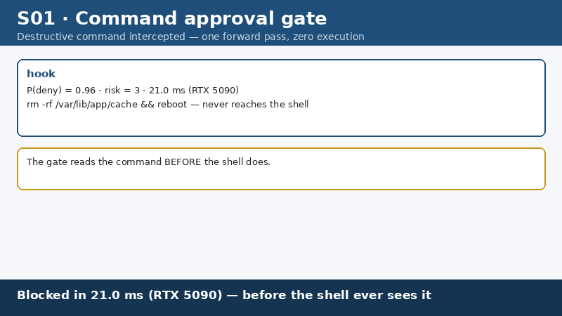

# phocinae-codebuddy-marketplace

Phocinae 的 CodeBuddy 插件市场清单。一个市场、一个插件：把斑海豹（Phocinae-Largha-150M-v1）
的**本地命令审批门**装进腾讯 CodeBuddy。

<p>
  
  
  
</p>


<p><sub>▲ <b>合成演示动画</b>（模型仓 docs/gallery S01）：画面为逐帧渲染、场景数据虚构，
但演示的「危险命令在毫秒级被拦下」与本市场提供的插件 gate 行为一致。</sub></p>

## 安装

```bash
# 1. 添加本市场（指向本仓）
/plugin marketplace add Phocinae/codebuddy-marketplace

# 2. 从本市场安装插件
/plugin install codebuddy-phocinae@phocinae-codebuddy-marketplace
```

装完后 hooks 与 skills 随插件启用即生效；`.mcp.json` 里的决策工具挂载是可选件，
默认注释说明清楚（见下）。

## 市场里有什么

| 插件 | 作用 | 形态 |
|---|---|---|
| `codebuddy-phocinae` | PreToolUse 硬门拦 Bash 命令，**deny 优先、fail-closed**；附决策提问技能；可选挂 `phocinae-mcp` | `hooks` + `skills` + `.mcp.json` |

插件的源码、完整文档与自测在
[Phocinae/codebuddy-phocinae](https://github.com/Phocinae/codebuddy-phocinae)；
本仓只承载市场清单，不改动插件本体。

## 前置条件

审批门本身**零第三方依赖**（纯标准库 Python），但需要有一个能给出裁决的后端：

- **推荐**：本机跑 `phocinae-guard`（L0 确定性表 + fail-closed），
  `pip install phocinae-guard`，或把 `PHOCINAE_GATE_GUARD` 指向你克隆的 `guard.py`；
- 或直连本机决策服务：`pip install phocinae-server` 后启动 8155，插件以 HTTP 后端裁决；
- 两者都没有时，插件**阻断**并打印可复制的配置指引 —— 不会静默放行。

`.mcp.json` 里的 `phocinae-mcp` 是**可选**的决策工具挂载。它通过 PyPI 安装
（`pip install phocinae-mcp`），**不是 npm 包**：早期版本误写成 `npx -y phocinae-mcp`，
那条命令永远不可能成功，因为 npm 上没有这个包名。现在文件里用的是正确的
`python -m phocinae_mcp` 形态。

## 为什么值得装

- **本地**：判定在本机完成，命令文本不出机器（服务只监听 127.0.0.1）。
- **确定性优先**：常见危险命令由离线表在毫秒级拦下，不依赖模型；模型只处理灰区。
- **fail-closed**：后端不可用、应答异常、解释器缺失 —— 一律阻断，绝不静默放行。
- **可核对**：插件仓内自带 JSON 校验与 hook 回归（24/24 + 21/21），可自行复跑。

## License

Apache-2.0，与插件本体一致。见 [LICENSE](LICENSE)。
